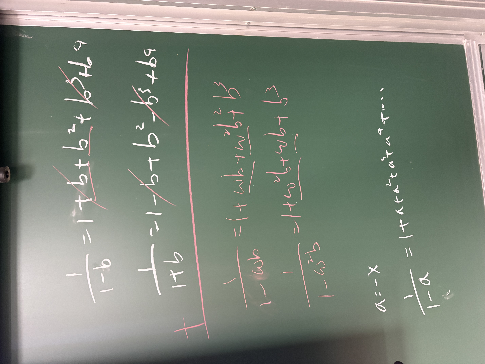
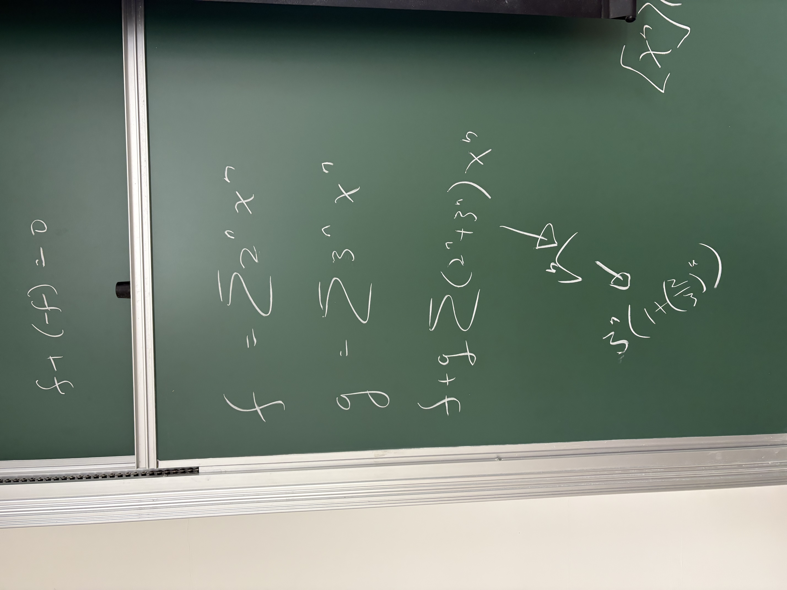
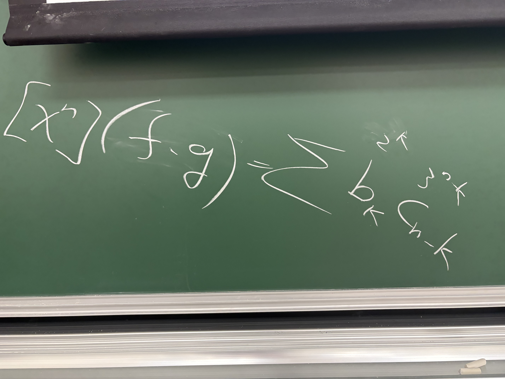
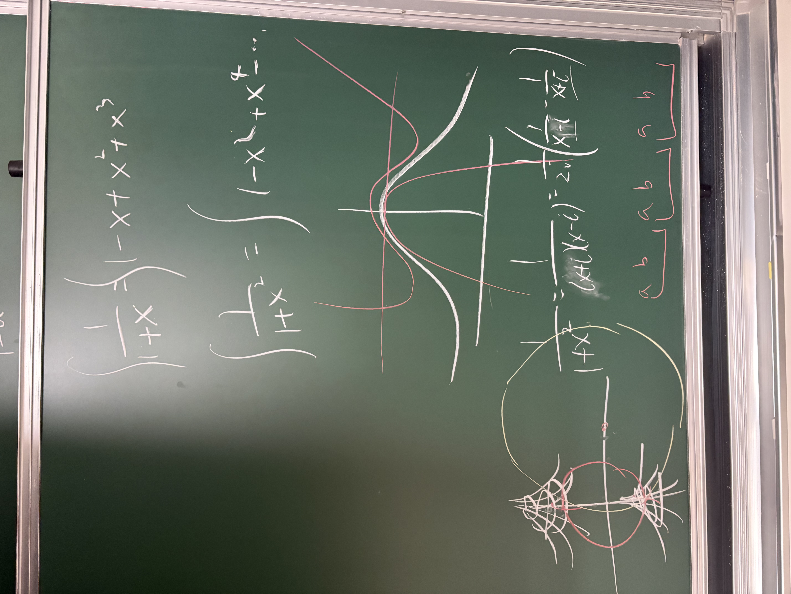

---
jupyter:
  jupytext:
    text_representation:
      extension: .md
      format_name: markdown
      format_version: '1.3'
      jupytext_version: 1.19.7
  kernelspec:
    display_name: SageMath 10.9
    language: sage
    name: sagemath
---

# ENGINEERING MATHEMATICS: DIFFERENTIAL EQUATIONS — 1118


## Chapter 6: Series Solutions of Linear Equations


Chapter 4 solved linear equations whose solutions are elementary:  
exponentials for constant coefficients,  
and powers for Cauchy–Euler equations.  
Most equations with variable coefficients have no such solutions;  
Airy's equation $y'' + xy = 0$ is the simplest example.


This chapter builds solutions as power series, one coefficient at a time.  
The equation itself becomes a recipe for the coefficients.

- 6.1: the tools for computing with power series.
- 6.2: series solutions centered at an ordinary point.
- 6.3: a power $x^r$ times a series, at a regular singular point.


## 6.1 Review of Power Series


### Power series and convergence


A **power series** centered at $a$ is an infinite sum
$$ \sum_{n=0}^\infty c_n (x - a)^n = c_0 + c_1 (x - a) + c_2 (x - a)^2 + \cdots. $$
It **converges** at $x$ if its partial sums have a limit,  
and **converges absolutely** if $\sum |c_n| |x - a|^n$ converges.


Every power series has a **radius of convergence** $R$,  
with $0 \le R \le \infty$:  
it converges absolutely for $|x - a| < R$  
and diverges for $|x - a| > R$.  
At the two endpoints $x = a \pm R$ anything can happen.  
In fact, for all complext numbers $|x - a| = R$ anything can happen.


The set of all $x$ where the series converges  
is its **interval of convergence**.  
It always contains the center $a$, where the sum is $c_0$.


### The ratio test


Suppose $|c_{n+1}/c_n| \to L$.  
The ratio of consecutive terms is
$$ \Bigl|\frac{c_{n+1}(x - a)^{n+1}}{c_n (x - a)^n}\Bigr| \to L|x - a|, $$
so the series converges absolutely when $L|x - a| < 1$  
and diverges when $L|x - a| > 1$.


Hence
$$ \boxed{R = \frac1L = \lim_{n\to\infty} \Bigl|\frac{c_n}{c_{n+1}}\Bigr|,} $$
with $R = \infty$ when $L = 0$ and $R = 0$ when $L = \infty$.


### Example 1: $\sum_{n=1}^\infty \frac{(x - 3)^n}{2^n n}$


Here $c_n = 1/(2^n n)$, and
$$ \Bigl|\frac{c_{n+1}}{c_n}\Bigr| = \frac{2^n n}{2^{n+1}(n + 1)} \to \frac12, $$
so $R = 2$, and the series converges absolutely on $(1, 5)$.


At the endpoints:

- $x = 5$ gives the harmonic series $\sum 1/n$, which diverges;
- $x = 1$ gives $\sum (-1)^n/n$,  
  which converges by the alternating series test.

The interval of convergence is $[1, 5)$.


### The root test


The ratio test needs $c_n \ne 0$ for all large $n$.  
It fails for series with gaps,  
such as the series solutions of Airy's equation in 6.2.  
The **root test** looks at $n$th roots instead of ratios.


If $|c_n|^{1/n} \to L$, the $n$th root of the $n$th term is
$$ \bigl|c_n (x - a)^n\bigr|^{1/n} = |c_n|^{1/n} |x - a| \to L|x - a|, $$
so the series converges absolutely when $L|x - a| < 1$  
and diverges when $L|x - a| > 1$.  
Again $R = 1/L$.


At a gap $|c_n|^{1/n} = 0$, so the limit may not exist.  
The largest limit along a subsequence,  
the **limit superior**, always exists:
$$ \boxed{\frac1R = \limsup_{n\to\infty} |c_n|^{1/n}.} $$
This is the **Cauchy–Hadamard formula**.  
When the ratio test applies, it gives the same $R$ and is usually easier.


### Example 2: a series with gaps


In $\sum_{n=0}^\infty \frac{x^{3n}}{8^n}$,  
only every third coefficient is nonzero:  
$c_{3n} = 8^{-n}$, and
$$ |c_{3n}|^{1/(3n)} = \bigl(8^{-n}\bigr)^{1/(3n)} = \frac12. $$
All other $|c_k|^{1/k}$ are $0$,  
so the limit superior is $\frac12$ and $R = 2$.


The substitution $u = x^3/8$ confirms this:  
the series becomes the geometric series $\sum u^n$,  
which converges exactly when $|u| < 1$, that is, $|x| < 2$.  
At $x = \pm2$, $|u| = 1$ and the series diverges,  
so the interval of convergence is $(-2, 2)$.





### Analytic functions


Inside $|x - a| < R$, the sum $f(x) = \sum c_n (x - a)^n$  
can be differentiated term by term:
$$ \begin{aligned}
f'(x) &= \sum_{n=1}^\infty nc_n (x - a)^{n-1}, \\
f''(x) &= \sum_{n=2}^\infty n(n - 1)c_n (x - a)^{n-2},
\end{aligned} $$
and the differentiated series have the same radius $R$,  
as proved below.


The sums start at $n = 1$ and $n = 2$  
because the terms with $n = 0$, or with $n = 0, 1$, vanish.  
Setting $x = a$ in $f^{(n)}$ leaves only one term,  
so $c_n = f^{(n)}(a)/n!$:  
a power series is the Taylor series of its sum.


A function is **analytic at $a$**  
if it equals a power series in $x - a$ near $a$.  
Polynomials, $e^x$, $\sin x$, and $\cos x$ are analytic everywhere.  
Sums, products, and compositions of analytic functions are analytic,  
and so is a quotient wherever the denominator is not $0$.


### How the radius changes


Let $\sum b_n (x - a)^n$ and $\sum c_n (x - a)^n$  
have radii $R_b$ and $R_c$.

| Operation | Radius of the result |
|---|---|
| derivative or antiderivative of $\sum c_n (x - a)^n$ | exactly $R_c$ |
| sum | at least $\min(R_b, R_c)$, and exactly $\min(R_b, R_c)$ if $R_b \ne R_c$ |
| product | at least $\min(R_b, R_c)$ |


#### Derivatives keep the radius


For $x \ne a$, the derivative series  
is a constant multiple of another series:
$$ \sum_{n=1}^\infty nc_n (x - a)^{n-1} = \frac1{x - a} \sum_{n=1}^\infty nc_n (x - a)^n, $$
so the two converge for the same $x$.  
The Cauchy–Hadamard formula compares their $n$th roots:  
$|nc_n|^{1/n} = n^{1/n} |c_n|^{1/n}$.


Since $\ln(n^{1/n}) = \frac{\ln n}{n} \to 0$,  
the factor $n^{1/n}$ tends to $1$,  
and a factor tending to $1$ does not change the limit superior:
$$ \limsup_{n\to\infty} |nc_n|^{1/n} = \limsup_{n\to\infty} |c_n|^{1/n} = \frac1{R_c}. $$
So the derivative has exactly the same radius.


The antiderivative $\sum \frac{c_n}{n + 1}(x - a)^{n+1}$  
has the original series as its derivative,  
so it has the same radius too.  
Repeating, $f'$, $f''$, $f'''$, $\ldots$ all have radius $R_c$.  
That the sum of the derivative series is exactly $f'$ is also true;  
its proof needs uniform convergence, and we take it for granted.


The endpoints can change.  
The series $\ln(1 + x) = x - \frac{x^2}{2} + \frac{x^3}{3} - \cdots$  
converges at $x = 1$,  
but its derivative $\frac1{1 + x} = 1 - x + x^2 - \cdots$ diverges there.


#### Sums keep at least the smaller radius


For $|x - a| < \min(R_b, R_c)$ both series converge,  
and the sum of two convergent series converges:
$$ \sum (b_n + c_n)(x - a)^n = \sum b_n (x - a)^n + \sum c_n (x - a)^n. $$
So the radius of the sum is at least $\min(R_b, R_c)$.


If $R_b < R_c$, it is exactly $R_b$.  
Take $R_b < |x - a| < R_c$.  
If the sum converged there,  
then $\sum b_n (x - a)^n$ would be a difference of two convergent series:
$$ \sum b_n (x - a)^n = \sum (b_n + c_n)(x - a)^n - \sum c_n (x - a)^n. $$
But $\sum b_n (x - a)^n$ diverges there.


If $R_b = R_c$, cancellation can make the radius larger.  
The series $\frac1{1 - x} = \sum_{n=0}^\infty x^n$  
and $-\frac{x}{1 - x} = -\sum_{n=1}^\infty x^n$ both have radius $1$,  
but their sum is the constant $1$, with radius $\infty$.





#### Products keep at least the smaller radius


Write $t = x - a$.  
The product of two series collects the terms of total power $n$:
$$ \begin{aligned}
\Bigl(\sum_{j=0}^\infty b_j t^j\Bigr)\Bigl(\sum_{k=0}^\infty c_k t^k\Bigr) &= \sum_{n=0}^\infty d_n t^n, \\
d_n &= \sum_{j=0}^n b_j c_{n-j}.
\end{aligned} $$
This is the **Cauchy product**.





Fix $|t| < \min(R_b, R_c)$, where both series converge absolutely.  
Each $|d_n| |t|^n$ is at most the sum of $|b_j| |t|^j |c_k| |t|^k$  
over $j + k = n$, so
$$ \begin{aligned}
\sum_{n=0}^N |d_n| |t|^n &\le \sum_{j+k\le N} |b_j| |t|^j |c_k| |t|^k \\
&\le \Bigl(\sum_{j=0}^\infty |b_j| |t|^j\Bigr)\Bigl(\sum_{k=0}^\infty |c_k| |t|^k\Bigr).
\end{aligned} $$


The partial sums of $\sum |d_n| |t|^n$ are bounded,  
so the product series converges absolutely for $|t| < \min(R_b, R_c)$.  
Absolute convergence allows the terms to be regrouped,  
so its sum is the product of the two sums.


Again the radius can be larger:  
$(1 - x) \cdot \frac1{1 - x} = 1$ has radius $\infty$,  
although $\frac1{1 - x}$ has radius $1$.  
In 6.2, products such as $\cos(x) y$ in Example 7  
converge at least where both factors do.


### Series to know


| $f(x)$ | Maclaurin series | Converges for |
|---|---|---|
| $e^x$ | $\sum_{n=0}^\infty \frac{x^n}{n!} = 1 + x + \frac{x^2}{2!} + \cdots$ | all $x$ |
| $\cos x$ | $\sum_{n=0}^\infty \frac{(-1)^n x^{2n}}{(2n)!} = 1 - \frac{x^2}{2!} + \cdots$ | all $x$ |
| $\sin x$ | $\sum_{n=0}^\infty \frac{(-1)^n x^{2n+1}}{(2n+1)!} = x - \frac{x^3}{3!} + \cdots$ | all $x$ |
| $\cosh x$ | $\sum_{n=0}^\infty \frac{x^{2n}}{(2n)!}$ | all $x$ |
| $\sinh x$ | $\sum_{n=0}^\infty \frac{x^{2n+1}}{(2n+1)!}$ | all $x$ |
| $\frac1{1 - x}$ | $\sum_{n=0}^\infty x^n = 1 + x + x^2 + \cdots$ | $\lvert x\rvert < 1$ |
| $\ln(1 + x)$ | $\sum_{n=1}^\infty \frac{(-1)^{n+1} x^n}{n} = x - \frac{x^2}{2} + \cdots$ | $-1 < x \le 1$ |
| $\arctan x$ | $\sum_{n=0}^\infty \frac{(-1)^n x^{2n+1}}{2n + 1} = x - \frac{x^3}{3} + \cdots$ | $-1 \le x \le 1$ |


New series come from these by substitution and term-by-term calculus.  
For example, replacing $x$ by $-x^2$ in the geometric series gives
$$ \frac1{1 + x^2} = \sum_{n=0}^\infty (-1)^n x^{2n} = 1 - x^2 + x^4 - \cdots, $$
and integrating term by term gives the series of $\arctan x$.


### Why the radius can be smaller than expected


The function $1/(1 + x^2)$ is analytic at every real $x$,  
yet its series above has $R = 1$:  
at $x = \pm1$ its terms do not even tend to $0$.  
Nothing happens to the function at $x = \pm1$.


The reason lies off the real line.  
Let $x$ be a complex number:  
$1/(1 + x^2)$ blows up at $x = \pm i$,  
at distance $1$ from the center $0$.  
A power series converges on a disk $|x - a| < R$ in the complex plane,  
and that disk cannot contain a point where the sum blows up.





For a rational function in lowest terms,  
the Taylor series at $a$ has $R$ equal to the distance from $a$  
to the nearest complex zero of the denominator.  
For example, the series of $1/(1 + x^2)$ centered at $a = 2$  
has $R = |2 - i| = \sqrt5$.


#### Picture: partial sums of $1/(1 + x^2)$


The partial sum up to $x^{2N}$ is a finite geometric sum:
$$ \sum_{n=0}^N (-1)^n x^{2n} = \frac{1 - (-x^2)^{N+1}}{1 + x^2}. $$
Its error $\pm x^{2N+2}/(1 + x^2)$ tends to $0$ exactly when $|x| < 1$.

```sage vscode={"languageId": "python"}
import numpy as np
from IPython.display import display, Math
x = SR.var('x')
```

```sage vscode={"languageId": "python"}
geometric_plot = plot(1/(1 + x**2), (x, -1.6, 1.6), color='black', thickness=2,
                      legend_label='$1/(1 + x^2)$')
for N, color in [(2, '#0072B2'), (3, '#009E73'), (10, '#D55E00'), (11, '#CC79A7')]:
    partial_sum = sum((-1)**n*x**(2*n) for n in range(N + 1))
    geometric_plot += plot(partial_sum, (x, -1.6, 1.6), color=color, legend_label=f'up to $x^{{{2*N}}}$')
for side in [-1, 1]:
    geometric_plot += line([(side, -1), (side, 2.5)], color='gray', linestyle=':')
geometric_plot.show(ymin=-1, ymax=2.5, figsize=[9, 4], frame=True, axes=False,
                    axes_labels=['$x$', '$y$'], legend_options={'loc': 'upper center', 'ncol': 3})
```

**Read the picture:**  
inside the dotted lines, more terms hug the black curve more closely.  
Outside, the partial sums peel away,  
alternately above and below,  
and the ones with more terms peel away sooner.  
The black curve gives no warning at $x = \pm1$;  
only the complex points $\pm i$ explain the wall.


### Shifting the summation index


Series solutions require adding series  
whose general terms carry different powers of $x$.  
For example, to write
$$ \sum_{n=2}^\infty n(n - 1)c_n x^{n-2} + \sum_{n=0}^\infty c_n x^{n+1} $$
as one series, two things must agree:  
the power of $x$ and the starting index.


**Powers.** Let $k$ be the power of $x$:  
$k = n - 2$ in the first sum and $k = n + 1$ in the second, so the sum is
$$ \sum_{k=0}^\infty (k + 2)(k + 1)c_{k+2} x^k + \sum_{k=1}^\infty c_{k-1} x^k. $$


**Starting indices.** The first sum starts one step earlier;  
write its $k = 0$ term $2c_2$ separately:
$$ 2c_2 + \sum_{k=1}^\infty \bigl((k + 2)(k + 1)c_{k+2} + c_{k-1}\bigr)x^k. $$


The index of summation is a dummy variable,  
like the variable of integration in a definite integral.  
To check a shift, compare the first terms:  
$n = 2$ in the original first sum and $k = 0$ after the shift  
both give $2c_2$.


### The identity property


If $\sum c_n (x - a)^n = 0$ for all $x$ near $a$,  
then every $c_n = 0$,  
since $c_n = f^{(n)}(a)/n!$ and $f$ is the zero function.  
So two power series that agree near $a$ have the same coefficients.  
This turns a differential equation into equations for the $c_n$.


### Example 3: a product of series


To multiply two series, collect the products of terms by total power,  
as for polynomials.  
For $e^x \sin x$, the coefficient of $x^3$ comes from  
$\frac{x^2}{2} \cdot x$ and $1 \cdot \bigl(-\frac{x^3}{6}\bigr)$,  
so it is $\frac12 - \frac16 = \frac13$.


Collecting the other powers in the same way,
$$ e^x \sin x = x + x^2 + \frac13 x^3 - \frac1{30} x^5 + \cdots. $$
The coefficient of $x^4$ is $\frac16 - \frac16 = 0$.  
By the product rule for radii,  
the product converges at least where both factors converge,  
here for all $x$.


### Example 4: a first series solution of $y' - 2xy = 0$


Substitute $y = \sum_{n=0}^\infty c_n x^n$.  
Then
$$ y' - 2xy = \sum_{n=1}^\infty nc_n x^{n-1} - \sum_{n=0}^\infty 2c_n x^{n+1}. $$
With $k = n - 1$ in the first sum and $k = n + 1$ in the second,
$$ y' - 2xy = c_1 + \sum_{k=1}^\infty \bigl((k + 1)c_{k+1} - 2c_{k-1}\bigr)x^k. $$


By the identity property, $c_1 = 0$ and
$$ c_{k+1} = \frac{2c_{k-1}}{k + 1}, \qquad k = 1, 2, 3, \ldots. $$
A formula that gives each coefficient from earlier ones  
is a **recurrence relation**.


This one steps by two,  
so the odd coefficients vanish with $c_1$,  
and the even ones follow from $c_0$:
$$ c_2 = c_0, \qquad c_4 = \frac{c_2}{2} = \frac{c_0}{2!}, \qquad c_6 = \frac{c_4}{3} = \frac{c_0}{3!}. $$


Hence
$$ \boxed{y = c_0 \sum_{m=0}^\infty \frac{x^{2m}}{m!} = c_0 e^{x^2},} $$
the solution that separation of variables gives in 2.2.  
The series method finds it without integrating,  
and the free constant is $c_0 = y(0)$.


## 6.2 Solutions About Ordinary Points


### Ordinary and singular points


Write a homogeneous second-order linear equation
$$ a_2(x) y'' + a_1(x) y' + a_0(x) y = 0 $$
in standard form $y'' + P(x) y' + Q(x) y = 0$,  
with $P = a_1/a_2$ and $Q = a_0/a_2$.


A point $x_0$ is an **ordinary point** of the equation  
if $P$ and $Q$ are both analytic at $x_0$,  
and a **singular point** otherwise.  
Complex points count:  
$x_0$ may be any complex number.


When $a_2$, $a_1$, $a_0$ are polynomials with no common factor,  
$x_0$ is an ordinary point exactly when $a_2(x_0) \ne 0$.  
These are the singular points of 4.1,  
now including complex ones.


### Example 1: classifying points


- $(x^2 - 1) y'' + 2xy' + 6y = 0$:  
  the singular points are $\pm1$.
- $(x^2 + 1) y'' + xy' - y = 0$:  
  the singular points are $\pm i$, and every real point is ordinary.
- $xy'' + \sin(x) y = 0$:  
  $Q = \frac{\sin x}{x} = 1 - \frac{x^2}{3!} + \cdots$ is analytic at $0$,  
  so there are no singular points at all.


### Existence of power series solutions


**Theorem.** If $x_0$ is an ordinary point,  
the equation has two linearly independent solutions of the form
$$ y = \sum_{n=0}^\infty c_n (x - x_0)^n. $$
Each converges at least on $|x - x_0| < R$,  
where $R$ is the distance from $x_0$ to the nearest singular point.


The free constants are $c_0 = y(x_0)$ and $c_1 = y'(x_0)$,  
the two initial values of 4.1;  
the recurrence determines every other $c_n$ from these two.  
Taking $(c_0, c_1) = (1, 0)$ and $(0, 1)$  
gives a fundamental set $y_1$, $y_2$, and $y = c_0 y_1 + c_1 y_2$.


With no singular points, $R = \infty$.  
The bound is only a guarantee:  
a series may converge farther,  
for instance when it stops after finitely many terms.  
We center at $x_0 = 0$;  
for another center, substitute $t = x - x_0$.


### Example 2: $y'' + y = 0$


With $y = \sum c_n x^n$, shift $y''$ so that its power is $x^k$:
$$ y'' + y = \sum_{k=0}^\infty \bigl((k + 2)(k + 1)c_{k+2} + c_k\bigr)x^k. $$
So the recurrence is
$$ c_{k+2} = -\frac{c_k}{(k + 2)(k + 1)}, \qquad k = 0, 1, 2, \ldots. $$


It steps by two and never mixes even and odd indices:
$$ \begin{aligned}
c_2 &= -\frac{c_0}{2!}, & c_4 &= \frac{c_0}{4!}, & c_6 &= -\frac{c_0}{6!}, \\
c_3 &= -\frac{c_1}{3!}, & c_5 &= \frac{c_1}{5!}, & c_7 &= -\frac{c_1}{7!}.
\end{aligned} $$
Hence $y = c_0 \cos x + c_1 \sin x$, as in 4.3:  
the series method rediscovers cosine and sine.


### Example 3: Airy's equation $y'' + xy = 0$


Airy introduced this equation to describe light near a rainbow.  
It has no singular points,  
so both series solutions converge for all $x$.


By the computation in 6.1,
$$ y'' + xy = 2c_2 + \sum_{k=1}^\infty \bigl((k + 2)(k + 1)c_{k+2} + c_{k-1}\bigr)x^k, $$
so $c_2 = 0$ and
$$ \boxed{c_{k+2} = -\frac{c_{k-1}}{(k + 2)(k + 1)}, \qquad k = 1, 2, 3, \ldots.} $$


The recurrence steps by three:  
$c_0$ determines $c_3, c_6, \ldots$,  
$c_1$ determines $c_4, c_7, \ldots$,  
and $c_2 = 0$ forces $c_5 = c_8 = \cdots = 0$.


With $(c_0, c_1) = (1, 0)$ and $(0, 1)$,
$$ \begin{aligned}
y_1 &= 1 - \frac{x^3}{6} + \frac{x^6}{180} - \frac{x^9}{12{,}960} + \cdots, \\
y_2 &= x - \frac{x^4}{12} + \frac{x^7}{504} - \frac{x^{10}}{45{,}360} + \cdots.
\end{aligned} $$


Each coefficient is the previous one  
divided by its own power and the number below it,  
for example $c_6 = -c_3/(6 \cdot 5)$, so
$$ y_1 = 1 + \sum_{k=1}^\infty \frac{(-1)^k x^{3k}}{2 \cdot 3 \cdot 5 \cdot 6 \cdots (3k - 1)(3k)}. $$


#### Picture: a spring that stiffens


For $x > 0$, write the equation as $y'' = -xy$:  
a spring whose stiffness $x$ grows.  
For $x < 0$, it reads $y'' = |x| y$,  
which pushes $y$ away from $0$.  
The code sums the series exactly in rational arithmetic  
and compares partial sums with the sum up to degree $150$.

```sage vscode={"languageId": "python"}
def airy_coefficients(c0, c1, N):
    # c_0, ..., c_N from c_2 = 0 and c_{k+2} = -c_{k-1}/((k + 2)(k + 1))
    c = [QQ(c0), QQ(c1), QQ(0)]
    for k in range(1, N - 1):
        c.append(-c[k - 1]/((k + 2)*(k + 1)))
    return c
def evaluate(coefficients, xs):
    return np.polyval([float(a) for a in reversed(coefficients)], xs)
airy_x = np.linspace(-3, 10, 2601)
airy_y1 = evaluate(airy_coefficients(1, 0, 150), airy_x)
```

```sage vscode={"languageId": "python"}
airy_plot = line(list(zip(airy_x, airy_y1)), color='black', thickness=2, legend_label='$y_1$')
for N, color in [(6, '#0072B2'), (15, '#009E73'), (30, '#D55E00'), (60, '#CC79A7')]:
    partial_sum = evaluate(airy_coefficients(1, 0, N), airy_x)
    airy_plot += line(list(zip(airy_x, partial_sum)), color=color, legend_label=f'up to $x^{{{N}}}$')
airy_plot.show(xmin=-3, xmax=10, ymin=-1.5, ymax=3, figsize=[9, 4], frame=True, axes=False,
               axes_labels=['$x$', '$y$'], legend_options={'loc': 'upper right', 'ncol': 3})
```

**Read the picture:**  
for $x > 0$ the solution oscillates faster and faster,  
with zeros near $1.98$, $3.82$, $5.29$, $6.58$, $\ldots$  
and a slowly shrinking amplitude:  
a stiffer spring vibrates faster and smaller.  
For $x < 0$ it grows faster than any exponential.


Each partial sum follows $y_1$ only up to a point  
and then shoots off like its leading term.  
The point moves out as terms are added:  
about $x = 2$ for degree $6$, $3.5$ for degree $15$,  
$5.3$ for degree $30$, and $8.2$ for degree $60$.  
$R = \infty$ means that enough terms reach any $x$,  
not that a few terms do.


### Example 4: $(x^2 + 1) y'' + xy' - y = 0$


The singular points are $\pm i$,  
so the theorem guarantees convergence for $|x| < 1$.  
Here
$$ (x^2 + 1) y'' = \sum_{n=2}^\infty n(n - 1)c_n x^n + \sum_{n=2}^\infty n(n - 1)c_n x^{n-2}. $$
Only the second sum needs a shift.


The other sums may start at $n = 0$, since the added terms are $0$.  
So the coefficient of $x^k$ is
$$ (k + 2)(k + 1)c_{k+2} + \bigl(k(k - 1) + k - 1\bigr)c_k = 0. $$
Since $k(k - 1) + k - 1 = (k + 1)(k - 1)$,
$$ c_{k+2} = \frac{1 - k}{k + 2} c_k, \qquad k = 0, 1, 2, \ldots. $$


For $k = 1$ the factor $1 - k$ vanishes:  
$c_3 = 0$, and with it every later odd coefficient.  
So $y_2 = x$, a polynomial, which converges for all $x$.  
The even coefficients never stop:
$$ y_1 = 1 + \frac{x^2}{2} - \frac{x^4}{8} + \frac{x^6}{16} - \frac{5x^8}{128} + \cdots. $$


This is the binomial series of $\sqrt{1 + x^2}$,  
and indeed $y = \sqrt{1 + x^2}$ solves the equation.  
It is smooth on the whole real line,  
but at $x = \pm i$ it is the square root of $0$,  
so its series at $0$ has $R = 1$ exactly,  
as $1/(1 + x^2)$ did in 6.1.


The solution itself lives on all of $(-\infty, \infty)$,  
since $x^2 + 1 \ne 0$ there.  
Only its series centered at $0$ stops at $|x| = 1$;  
centered at $x_0 = 2$, the series converges for $|x - 2| < \sqrt5$.


### Example 5: Legendre's equation with $n = 1$, again


In 4.2, reduction of order started from $y_1 = x$ for
$$ (1 - x^2) y'' - 2xy' + 2y = 0 $$
and found $y_2 = \frac x2 \ln\frac{1 + x}{1 - x} - 1$.  
Now the series method finds both at once.  
The singular points are $\pm1$, so $R \ge 1$.


The coefficient of $x^k$ gives
$$ (k + 2)(k + 1)c_{k+2} - \bigl(k(k - 1) + 2k - 2\bigr)c_k = 0, $$
and $k(k - 1) + 2k - 2 = (k + 2)(k - 1)$, so
$$ c_{k+2} = \frac{k - 1}{k + 1} c_k, \qquad k = 0, 1, 2, \ldots. $$


Again $c_3 = 0$, so the odd solution is $x$.  
The even coefficients are  
$c_2 = -c_0$, $c_4 = -\frac13 c_0$, $c_6 = -\frac15 c_0$, and so on:
$$ y = 1 - x^2 - \frac{x^4}{3} - \frac{x^6}{5} - \cdots = 1 - \frac x2 \ln\frac{1 + x}{1 - x}, $$
using $\frac12 \ln\frac{1 + x}{1 - x} = x + \frac{x^3}{3} + \frac{x^5}{5} + \cdots$.  
This is $-y_2$.


Here $R = 1$ is sharp for a different reason than in Example 4:  
the singular points $\pm1$ are real,  
and the solution really blows up there.


For Legendre's equation $(1 - x^2) y'' - 2xy' + n(n + 1) y = 0$,  
the same computation gives
$$ c_{k+2} = -\frac{(n - k)(n + k + 1)}{(k + 2)(k + 1)} c_k. $$
When $n$ is a nonnegative integer,  
the factor $n - k$ stops one of the two series at degree $n$.  
These polynomial solutions are the **Legendre polynomials**,  
which appear in problems with spherical symmetry.


### Example 6: a three-term recurrence


For $y'' - (1 + x) y = 0$,
$$ \begin{aligned}
y'' - y - xy &= 2c_2 - c_0 \\
&\quad + \sum_{k=1}^\infty \bigl((k + 2)(k + 1)c_{k+2} - c_k - c_{k-1}\bigr)x^k,
\end{aligned} $$
so $c_2 = c_0/2$ and
$$ c_{k+2} = \frac{c_k + c_{k-1}}{(k + 2)(k + 1)}, \qquad k = 1, 2, 3, \ldots. $$


Now each coefficient depends on two earlier ones,  
and there is no simple formula for $c_n$.  
The first terms are still easy to compute.  
With $(c_0, c_1) = (1, 0)$ and $(0, 1)$,
$$ \begin{aligned}
y_1 &= 1 + \frac{x^2}{2} + \frac{x^3}{6} + \frac{x^4}{24} + \frac{x^5}{30} + \cdots, \\
y_2 &= x + \frac{x^3}{6} + \frac{x^4}{12} + \frac{x^5}{120} + \cdots.
\end{aligned} $$
Both converge for all $x$.


### Example 7: $y'' + \cos(x) y = 0$


The coefficient $\cos x$ is analytic everywhere,  
so there are no singular points.  
Replace $\cos x$ by its Maclaurin series and multiply as in 6.1:
$$ \cos(x) y = \Bigl(1 - \frac{x^2}{2} + \cdots\Bigr)(c_0 + c_1 x + c_2 x^2 + \cdots). $$


Collecting each power of $x$ in $y'' + \cos(x) y = 0$,
$$ \begin{aligned}
2c_2 + c_0 &= 0, && (x^0) \\
6c_3 + c_1 &= 0, && (x^1) \\
12c_4 + c_2 - \frac12 c_0 &= 0, && (x^2) \\
20c_5 + c_3 - \frac12 c_1 &= 0. && (x^3)
\end{aligned} $$


Solving one equation at a time,
$$ \begin{aligned}
y_1 &= 1 - \frac{x^2}{2} + \frac{x^4}{12} - \frac{x^6}{80} + \cdots, \\
y_2 &= x - \frac{x^3}{6} + \frac{x^5}{30} - \frac{19x^7}{5{,}040} + \cdots.
\end{aligned} $$
Each coefficient now depends on all the earlier ones,  
so no general term is expected.


### Taylor coefficients directly


For an initial value problem,  
the coefficients $c_n = y^{(n)}(0)/n!$  
can also be found by differentiating the equation.  
For $y'' = -\cos(x) y$ with $y(0) = 1$ and $y'(0) = 0$,
$$ \begin{aligned}
y''' &= \sin(x) y - \cos(x) y', \\
y^{(4)} &= \cos(x) y + 2\sin(x) y' - \cos(x) y''.
\end{aligned} $$


At $x = 0$ these give $y''(0) = -1$, $y'''(0) = 0$,  
and $y^{(4)}(0) = 1 - (-1) = 2$,  
so $c_2 = -\frac12$, $c_3 = 0$, and $c_4 = \frac2{24} = \frac1{12}$,  
as in Example 7.  
This also works for nonlinear equations,  
where no recurrence is available.


### The method in steps


To solve $a_2 y'' + a_1 y' + a_0 y = 0$ about an ordinary point $x_0 = 0$:

1. Substitute $y = \sum c_n x^n$ and its derivatives.
2. Shift each sum so that its general term carries $x^k$.
3. Write out the first terms so that all sums start at the same $k$.
4. Set each coefficient to $0$,  
   and solve for the coefficient with the largest index.
5. Use $(c_0, c_1) = (1, 0)$ and $(0, 1)$ to get $y_1$ and $y_2$.


## 6.3 Solutions About Singular Points


### When power series fail


At a singular point the theorem of 6.2 says nothing,  
and power series solutions may not exist.  
The Cauchy–Euler equation $2x^2 y'' + 3xy' - y = 0$ of 4.7  
has the auxiliary equation $2m^2 + m - 1 = (2m - 1)(m + 1) = 0$,  
so $y = c_1 x^{1/2} + c_2 x^{-1}$ on $(0, \infty)$.


Neither $x^{1/2}$ nor $x^{-1}$ is a power series in $x$.  
Substituting $y = \sum c_n x^n$ gives $(2n^2 + n - 1)c_n = 0$ for every $n$,  
so every $c_n = 0$.  
The fix is to allow a power $x^r$ in front of the series.


### Regular and irregular singular points


A singular point $x_0$ is **regular** if
$$ p(x) = (x - x_0) P(x) \quad\text{and}\quad q(x) = (x - x_0)^2 Q(x) $$
are both analytic at $x_0$, and **irregular** otherwise.  
So $P$ may blow up at most like $1/(x - x_0)$,  
and $Q$ at most like $1/(x - x_0)^2$.


For polynomial coefficients, write $P$ and $Q$ in lowest terms:  
$x_0$ is regular when the factor $x - x_0$ appears  
at most once in the denominator of $P$  
and at most twice in the denominator of $Q$.


### Example 1: classifying singular points


For $(x^2 - 4)^2 y'' + 3(x - 2) y' + 5y = 0$,  
divide by $(x^2 - 4)^2 = (x - 2)^2 (x + 2)^2$:
$$ P = \frac{3}{(x - 2)(x + 2)^2}, \qquad Q = \frac{5}{(x - 2)^2 (x + 2)^2}. $$


- At $x = 2$, the factor $x - 2$ appears once in $P$ and twice in $Q$:  
  a regular singular point.
- At $x = -2$, the factor $x + 2$ appears twice in $P$:  
  an irregular singular point.


Every Cauchy–Euler equation $ax^2 y'' + bxy' + cy = 0$  
has a regular singular point at $0$,  
with the constants $p = b/a$ and $q = c/a$.  
Legendre's equation has regular singular points at $\pm1$.


### Frobenius' theorem


**Theorem (Frobenius).** If $x_0$ is a regular singular point,  
there is at least one solution of the form
$$ y = \sum_{n=0}^\infty c_n (x - x_0)^{n+r}, \qquad c_0 \ne 0, $$
where the exponent $r$ is a constant to be found.  
The series converges at least on $0 < x - x_0 < R$,  
where $R$ is the distance from $x_0$ to the nearest other singular point.


The exponent $r$ need not be an integer,  
so we work on the side $x > x_0$,  
as for Cauchy–Euler equations.  
For $x < x_0$, replace $(x - x_0)^r$ by $|x - x_0|^r$.  
Below we take $x_0 = 0$.


### The indicial equation


Multiply the standard form by $x^2$:
$$ x^2 y'' + xp(x) y' + q(x) y = 0, $$
with $p = xP$ and $q = x^2 Q$ analytic at $0$.  
Near $x = 0$, $p(x) \approx p_0 = p(0)$ and $q(x) \approx q_0 = q(0)$,  
so the equation is close to the Cauchy–Euler equation  
$x^2 y'' + p_0 xy' + q_0 y = 0$.


Substitute $y = \sum c_n x^{n+r}$.  
The lowest power is $x^r$, and only $c_0$ contributes to it:
$$ x^2 y'' + xpy' + qy = c_0\bigl(r(r - 1) + p_0 r + q_0\bigr)x^r + \cdots. $$
Since $c_0 \ne 0$, the exponent $r$ must solve the **indicial equation**
$$ \boxed{r(r - 1) + p_0 r + q_0 = 0.} $$


This is the auxiliary equation of the Cauchy–Euler equation  
obtained by freezing $p$ and $q$ at $0$.  
Its roots are the **indicial roots**, or **exponents**, of the singular point;  
when they are real, we label them $r_1 \ge r_2$.


### Example 2: $3xy'' + y' - y = 0$


Here $P = \frac1{3x}$ and $Q = -\frac1{3x}$,  
so $p = \frac13$ and $q = -\frac x3$, with $p_0 = \frac13$ and $q_0 = 0$.  
The indicial equation is $r(r - 1) + \frac13 r = r\bigl(r - \frac23\bigr) = 0$,  
so $r_1 = \frac23$ and $r_2 = 0$.


For the recurrence, substitute $y = \sum c_n x^{n+r}$ directly.  
The terms $3xy''$ and $y'$ both lower the power by one:
$$ 3xy'' + y' = \sum_{n=0}^\infty (n + r)(3n + 3r - 2)c_n x^{n+r-1}. $$


With $k = n - 1$ there, and $k = n$ in $-y = -\sum c_n x^{n+r}$,
$$ \begin{aligned}
&3xy'' + y' - y \\
&\quad = r(3r - 2)c_0 x^{r-1} \\
&\qquad + \sum_{k=0}^\infty \bigl((k + r + 1)(3k + 3r + 1)c_{k+1} - c_k\bigr)x^{k+r}.
\end{aligned} $$
The first term is the indicial equation again.


The rest gives the recurrence
$$ c_{k+1} = \frac{c_k}{(k + r + 1)(3k + 3r + 1)}, \qquad k = 0, 1, 2, \ldots. $$
Its denominator is $(k + 1)(3k + 5)$ for $r_1 = \frac23$,  
and $(k + 1)(3k + 1)$ for $r_2 = 0$.


With $c_0 = 1$, the two roots give
$$ \begin{aligned}
y_1 &= x^{2/3}\Bigl(1 + \frac x5 + \frac{x^2}{80} + \frac{x^3}{2{,}640} + \cdots\Bigr), \\
y_2 &= 1 + x + \frac{x^2}{8} + \frac{x^3}{168} + \cdots.
\end{aligned} $$
Since $c_{k+1}/c_k \to 0$, both series converge for all $x$.  
On $(0, \infty)$ the general solution is $y = C_1 y_1 + C_2 y_2$.


### Three cases


As for Cauchy–Euler equations,  
the indicial roots decide the form of the second solution.

| Indicial roots | $y_1$ | $y_2$ |
|---|---|---|
| $r_1 - r_2$ not an integer | $\sum c_n x^{n+r_1}$ | $\sum b_n x^{n+r_2}$ |
| $r_1 - r_2$ a positive integer | $\sum c_n x^{n+r_1}$ | $Cy_1 \ln x + \sum b_n x^{n+r_2}$, where $C$ may be $0$ |
| $r_1 = r_2$ | $\sum c_n x^{n+r_1}$ | $y_1 \ln x + \sum b_n x^{n+r_1}$ |


Here $c_0 \ne 0$ and $b_0 \ne 0$,  
except in the last row, where $b_0$ may be taken to be $0$.  
Complex roots $\alpha \pm i\beta$ belong to the first row;  
the real and imaginary parts of the series for $\alpha + i\beta$  
are two real solutions, as in 4.7.


Example 2 is the first row.  
The last row is the analogue of $x^{m_1} \ln x$  
for a repeated root in 4.7.  
The middle row needs a closer look.


### Why an integer gap is special


In general, the coefficient of $x^{n+r}$ gives
$$ F(n + r) c_n = -\sum_{j=1}^n \bigl((n - j + r) p_j + q_j\bigr)c_{n-j}, $$
where $F(r) = r(r - 1) + p_0 r + q_0$ is the indicial polynomial,  
and $p_j$, $q_j$ are the Maclaurin coefficients of $p$ and $q$.


For $r = r_1$, the factor $F(n + r_1)$ never vanishes for $n \ge 1$,  
since $n + r_1$ would be a root larger than $r_1$.  
So the larger root always gives a Frobenius series.


For $r = r_2$ and an integer gap $N = r_1 - r_2$,  
$F(N + r_2) = F(r_1) = 0$,  
and the step $n = N$ reads $0 \cdot c_N = (\text{right-hand side})$.

- If the right-hand side is $0$, then $c_N$ is free,  
  and the series for $r_2$ works: $C = 0$.
- Otherwise no series exists for $r_2$,  
  and the term $Cy_1 \ln x$ is needed.


### Example 3: $xy'' + (x - 6) y' - 3y = 0$


Here $p = x - 6$ and $q = -3x$, so $p_0 = -6$ and $q_0 = 0$,  
and $r(r - 1) - 6r = r(r - 7) = 0$ gives $r_1 = 7$ and $r_2 = 0$.  
Substituting $y = \sum c_n x^{n+r}$ and collecting $x^{k+r}$,
$$ (k + r + 1)(k + r - 6)c_{k+1} + (k + r - 3)c_k = 0. $$


For $r_2 = 0$ this is
$$ (k + 1)(k - 6)c_{k+1} = -(k - 3)c_k. $$
For $k = 0, 1, 2$ it gives  
$c_1 = -\frac12 c_0$, $c_2 = \frac1{10} c_0$, $c_3 = -\frac1{120} c_0$,  
and then $c_4 = c_5 = c_6 = 0$ because of the factor $k - 3$.


At $k = 6$ the equation reads $7 \cdot 0 \cdot c_7 = -3c_6 = 0$:  
the right-hand side vanishes, so $c_7$ is free and $C = 0$.  
Taking $c_0 = 1$ and $c_7 = 0$ gives a polynomial solution,
$$ y_2 = 1 - \frac x2 + \frac{x^2}{10} - \frac{x^3}{120}. $$


A nonzero $c_7$ only adds a multiple of the series for $r_1 = 7$.  
That series has $c_{k+1} = -\frac{k + 4}{(k + 1)(k + 8)} c_k$, so
$$ y_1 = x^7\Bigl(1 - \frac x2 + \frac{5x^2}{36} - \frac{x^3}{36} + \cdots\Bigr). $$


### Example 4: Bessel's equation of order $\frac12$


The functions $x^{-1/2} \cos x$ and $x^{-1/2} \sin x$  
of homework A6 in 1104 solve
$$ x^2 y'' + xy' + \Bigl(x^2 - \frac14\Bigr) y = 0. $$
Here $p = 1$ and $q = x^2 - \frac14$,  
so $r^2 - \frac14 = 0$:  
the roots $r_1 = \frac12$ and $r_2 = -\frac12$ differ by $1$.


Since $q$ has only the extra term $x^2$,  
the general recurrence for $r = -\frac12$ reads
$$ \Bigl(\Bigl(n - \frac12\Bigr)^2 - \frac14\Bigr)c_n = n(n - 1)c_n = -c_{n-2}. $$
At $n = 1$ it reads $0 \cdot c_1 = 0$:  
$c_1$ is free, and $C = 0$.


The recurrence $c_n = -c_{n-2}/\bigl(n(n - 1)\bigr)$  
is that of Example 2 in 6.2,  
so the even and odd coefficients give the cosine and sine series:
$$ y = c_0 x^{-1/2} \cos x + c_1 x^{-1/2} \sin x. $$
The smaller root alone produced both solutions;  
the series for $r_1 = \frac12$ is $x^{-1/2} \sin x$ again.


### Example 5: $xy'' + y = 0$, where a logarithm is needed


Here $p = 0$ and $q = x$, so $r(r - 1) = 0$, with $r_1 = 1$ and $r_2 = 0$.  
The coefficient of $x^{n+r-1}$ gives
$$ (n + r)(n + r - 1)c_n + c_{n-1} = 0. $$


For $r_1 = 1$, $c_n = -c_{n-1}/\bigl(n(n + 1)\bigr)$, so
$$ y_1 = \sum_{n=0}^\infty \frac{(-1)^n x^{n+1}}{n!(n + 1)!} = x - \frac{x^2}{2} + \frac{x^3}{12} - \frac{x^4}{144} + \cdots. $$
For $r_2 = 0$, the step $n = 1$ reads $0 \cdot c_1 + c_0 = 0$,  
which contradicts $c_0 \ne 0$:  
there is no second Frobenius series.


So try $y_2 = y_1 \ln x + w$ with $w = \sum_{n=0}^\infty b_n x^n$,  
taking $C = 1$.  
Since $(y_1 \ln x)'' = y_1'' \ln x + 2y_1'/x - y_1/x^2$,
$$ xy_2'' + y_2 = (xy_1'' + y_1) \ln x + 2y_1' - \frac{y_1}x + xw'' + w. $$


The first term vanishes because $y_1$ is a solution,  
so $w$ must solve
$$ xw'' + w = \frac{y_1}x - 2y_1' = -1 + \frac32 x - \frac5{12} x^2 + \cdots. $$
The left-hand side is $\sum \bigl((n + 1)nb_{n+1} + b_n\bigr)x^n$.


Matching powers:

- $x^0$: $0 \cdot b_1 + b_0 = -1$, so $b_0 = -1$;  
  $b_1$ is free, and we take $b_1 = 0$.
- $x^1$: $2b_2 + b_1 = \frac32$, so $b_2 = \frac34$.
- $x^2$: $6b_3 + b_2 = -\frac5{12}$, so $b_3 = -\frac7{36}$.


Therefore
$$ y_2 = y_1 \ln x - 1 + \frac34 x^2 - \frac7{36} x^3 + \cdots. $$
The logarithm supplies the term $-1$ on the right-hand side  
that the step $n = 1$ was missing.  
Another choice of $b_1$ adds $b_1 y_1$ to $y_2$.


Reduction of order from 4.2 leads to the same $y_2$.  
Here $P = 0$, so $y_2 = y_1 \int dx/y_1^2$,  
and $1/y_1^2 = x^{-2}(1 + x + \cdots)$.  
The term $x^{-1}$ integrates to $\ln x$:  
this is where the logarithm comes from.


### Example 6: Bessel's equation of order $0$


The equation $xy'' + y' + xy = 0$, or $x^2 y'' + xy' + x^2 y = 0$,  
is **Bessel's equation of order $0$**.  
Here $p = 1$ and $q = x^2$,  
so the indicial equation $r^2 = 0$ has the double root $r = 0$.


For $r = 0$, the coefficient of $x^{n-1}$ gives $n^2 c_n + c_{n-2} = 0$,  
so $c_1 = 0$ and, with $c_0 = 1$,
$$ \begin{aligned}
y_1 &= \sum_{k=0}^\infty \frac{(-1)^k}{(k!)^2}\Bigl(\frac x2\Bigr)^{2k} \\
&= 1 - \frac{x^2}{4} + \frac{x^4}{64} - \frac{x^6}{2{,}304} + \cdots.
\end{aligned} $$
This is the **Bessel function** $J_0(x)$.


For $y_2 = y_1 \ln x + w$,  
the same computation as in Example 5 gives
$$ xw'' + w' + xw = -2y_1' = x - \frac{x^3}{8} + \frac{x^5}{192} - \cdots. $$


Matching powers with $w = \sum b_n x^n$ and $b_0 = 0$,
$$ y_2 = J_0(x) \ln x + \frac{x^2}{4} - \frac{3x^4}{128} + \frac{11x^6}{13{,}824} - \cdots. $$
The usual second solution is  
$Y_0 = \frac2\pi\bigl(y_2 + (\gamma - \ln2) J_0\bigr)$,  
where $\gamma \approx 0.5772$ is Euler's constant.


#### Picture: the two solutions of Bessel's equation of order $0$


Plot $J_0$ and $y_2$ from their series.  
In standard form the equation reads $y'' + \frac1x y' + y = 0$:  
the term $\frac1x y'$ acts like a friction  
that weakens as $x$ grows.

```sage vscode={"languageId": "python"}
bessel_x = np.linspace(0, 20, 2001)[1:]
J0_coefficients, w_coefficients = [QQ(0)]*81, [QQ(0)]*81
for k in range(41):
    J0_coefficients[2*k] = (-1)**k/(4**k*factorial(k)**2)
    w_coefficients[2*k] = (-1)**(k + 1)*harmonic_number(k)/(4**k*factorial(k)**2)
bessel_J0 = evaluate(J0_coefficients, bessel_x)
bessel_y2 = bessel_J0*np.log(bessel_x) + evaluate(w_coefficients, bessel_x)
```

```sage vscode={"languageId": "python"}
bessel_plot = line(list(zip(bessel_x, bessel_J0)), color='#0072B2', thickness=2, legend_label='$J_0$')
bessel_plot += line(list(zip(bessel_x, bessel_y2)), color='#D55E00', thickness=2,
                    legend_label=r'$y_2 = J_0 \ln x + \cdots$')
for sign in [1, -1]:
    bessel_plot += line(list(zip(bessel_x, sign*np.sqrt(2/(np.pi*bessel_x)))), color='gray',
                        linestyle='--')
bessel_plot.show(xmin=0, xmax=20, ymin=-1.5, ymax=1.5, figsize=[9, 4], frame=True, axes=False,
                 axes_labels=['$x$', '$y$'], legend_options={'loc': 'lower right'})
```

**Read the picture:**  
away from $0$, both solutions look like cosines  
whose amplitude decays like $\sqrt{2/(\pi x)}$, the dashed envelope.  
Near $0$ they differ completely:  
$J_0(0) = 1$, while $y_2 \to -\infty$ like $\ln x$.  
So a solution that stays bounded at $x = 0$ is a multiple of $J_0$.


### Irregular singular points


At an irregular singular point Frobenius' theorem does not apply,  
and a formal series may diverge for every $x \ne 0$.  
For $x^2 y'' + (3x - 1) y' + y = 0$,  
$xP = (3x - 1)/x$ is not analytic at $0$, so $0$ is irregular.


Substituting $y = \sum c_n x^n$, the coefficient of $x^n$ is  
$(n + 1)^2 c_n - (n + 1)c_{n+1}$,  
since $n(n - 1) + 3n + 1 = (n + 1)^2$.  
So $c_{n+1} = (n + 1)c_n$ and $y = c_0 \sum n!\,x^n$.  
The ratio test gives $R = 0$:  
the series is not a solution on any interval.


### Summary


| Task | Tool |
|---|---|
| Radius of a power series | $R = \lim\lvert c_n/c_{n+1}\rvert$, or $1/R = \limsup\lvert c_n\rvert^{1/n}$ for gaps; check the endpoints separately |
| Add series | shift so that every term carries $x^k$; write out terms to align the starts |
| Classify $x_0$ | ordinary: $P$, $Q$ analytic; regular singular: $(x - x_0) P$, $(x - x_0)^2 Q$ analytic |
| Solve about an ordinary point | $y = \sum c_n x^n$; $R \ge$ distance to the nearest complex singular point |
| Solve about a regular singular point | $y = \sum c_n x^{n+r}$ with $r(r - 1) + p_0 r + q_0 = 0$ |
| Second solution at a singular point | a second series, or $Cy_1 \ln x + \sum b_n x^{n+r_2}$, or $y_1 \ln x + \sum b_n x^{n+r_1}$ |


### Practice habits for series solutions


- Shift every sum to the power $x^k$,  
  and check each shift by comparing first terms.
- Align the starting indices before combining sums.
- Solve the recurrence for the coefficient with the largest index.
- Look for singular points in the complex plane when estimating $R$.
- At a singular point, find $p_0$ and $q_0$ first;  
  the indicial equation is a Cauchy–Euler auxiliary equation.
- When the indicial roots differ by an integer, start with the larger root.


### Exam vocabulary


| Phrase | 中文 | What to write |
|---|---|---|
| **power series**, **radius of convergence** | 冪級數、收斂半徑 | $\sum c_n (x - a)^n$, $R = \lim\lvert c_n/c_{n+1}\rvert$ |
| **ratio test**, **root test** | 比值審斂法、根式審斂法 | $R = \lim\lvert c_n/c_{n+1}\rvert$, $1/R = \limsup\lvert c_n\rvert^{1/n}$ |
| **analytic at $a$** | 在 $a$ 解析 | equals a power series near $a$ |
| **recurrence relation** | 遞迴關係 | each $c_n$ from earlier coefficients |
| **ordinary point**, **singular point** | 常點、奇點 | $P$ and $Q$ analytic or not |
| **regular singular point** | 正則奇點 | $(x - x_0) P$, $(x - x_0)^2 Q$ analytic |
| **indicial equation**, **indicial roots** | 指標方程、指標根 | $r(r - 1) + p_0 r + q_0 = 0$ |
| **method of Frobenius** | Frobenius 法 | $y = \sum c_n x^{n+r}$, $c_0 \ne 0$ |


## Checking Worked Solutions with Sage


Sage computes series coefficients in exact rational arithmetic,  
so it can check every coefficient above.  
The functions below follow the recurrences of 6.2 and 6.3  
without using the closed forms found by hand.

```sage vscode={"languageId": "python"}
Rx = PolynomialRing(QQ, 'x'); X = Rx.gen()
def ordinary_taylor(a2, a1, a0, y0, dy0, N):
    # degree-N Taylor polynomial at 0 of the solution of a2 y'' + a1 y' + a0 y = 0
    # with y(0) = y0 and y'(0) = dy0; a2, a1, a0 are polynomials in X with a2(0) != 0
    a2, a1, a0 = Rx(a2), Rx(a1), Rx(a0)
    y = Rx(y0) + dy0*X
    for k in range(N - 1):
        residual = (a2*y.derivative(X, 2) + a1*y.derivative(X) + a0*y)[k]
        y += -residual/(a2[0]*(k + 2)*(k + 1))*X**(k + 2)
    return y
```

```sage vscode={"languageId": "python"}
cos_polynomial = sum((-1)**k*X**(2*k)/factorial(2*k) for k in range(6))
ordinary_checks = [
    # name, (a2, a1, a0), degree N, y1 and y2 by hand through degree N
    ('6.2 Ex 2', (1, 0, 1), 7, 1 - X**2/2 + X**4/24 - X**6/720, X - X**3/6 + X**5/120 - X**7/5040),
    ('6.2 Ex 3', (1, 0, X), 10, 1 - X**3/6 + X**6/180 - X**9/12960,
                                X - X**4/12 + X**7/504 - X**10/45360),
    ('6.2 Ex 4', (X**2 + 1, X, -1), 8, 1 + X**2/2 - X**4/8 + X**6/16 - 5*X**8/128, X),
    ('6.2 Ex 5', (1 - X**2, -2*X, 2), 7, 1 - X**2 - X**4/3 - X**6/5, X),
    ('6.2 Ex 6', (1, 0, -1 - X), 5, 1 + X**2/2 + X**3/6 + X**4/24 + X**5/30,
                                X + X**3/6 + X**4/12 + X**5/120),
    ('6.2 Ex 7', (1, 0, cos_polynomial), 7, 1 - X**2/2 + X**4/12 - X**6/80,
                                X - X**3/6 + X**5/30 - 19*X**7/5040),
]
for name, (a2, a1, a0), N, y1, y2 in ordinary_checks:
    assert ordinary_taylor(a2, a1, a0, 1, 0, N) == y1, name
    assert ordinary_taylor(a2, a1, a0, 0, 1, N) == y2, name
print('Series agree:', ', '.join(name for name, *_ in ordinary_checks))
```

```sage vscode={"languageId": "python"}
x = SR.var('x')
closed_forms = [('6.1 Ex 3', exp(x)*sin(x), 5, x + x**2 + x**3/3 - x**5/30),
                ('6.1 Ex 4', exp(x**2), 6, 1 + x**2 + x**4/2 + x**6/6),
                ('6.2 Ex 4', sqrt(1 + x**2), 8, 1 + x**2/2 - x**4/8 + x**6/16 - 5*x**8/128),
                ('6.2 Ex 5', 1 - x/2*log((1 + x)/(1 - x)), 6, 1 - x**2 - x**4/3 - x**6/5)]
for name, f, n, by_hand in closed_forms:
    assert (taylor(f, x, 0, n) - by_hand).expand() == 0, name
print('Taylor polynomials agree:', ', '.join(name for name, *_ in closed_forms))
```

Airy's series also shows the power series ring of Sage,  
which prints a truncated series with its order term:

```sage vscode={"languageId": "python"}
PowerSeriesRing(QQ, 'x')(ordinary_taylor(1, 0, X, 1, 0, 15)).add_bigoh(16)
```

```sage vscode={"languageId": "python"}
def frobenius_series(p, q, r, N):
    # c_0, ..., c_N with c_0 = 1 for y = sum c_n x^(n+r) solving x^2 y'' + x p y' + q y = 0;
    # p and q are polynomials in X, and F(n + r) must not vanish for 1 <= n <= N
    p, q, r = Rx(p), Rx(q), QQ(r)
    F = lambda s: s*(s - 1) + p[0]*s + q[0]
    c = [QQ(1)]
    for n in range(1, N + 1):
        c.append(-sum(((n - j + r)*p[j] + q[j])*c[n - j] for j in range(1, n + 1))/F(n + r))
    return Rx(c)
```

```sage vscode={"languageId": "python"}
frobenius_checks = [
    # name, p, q, r, degree, the series without x^r by hand through that degree
    ('6.3 Ex 2, r = 2/3', 1/3, -X/3, 2/3, 3, 1 + X/5 + X**2/80 + X**3/2640),
    ('6.3 Ex 2, r = 0', 1/3, -X/3, 0, 3, 1 + X + X**2/8 + X**3/168),
    ('6.3 Ex 3, r = 7', X - 6, -3*X, 7, 3, 1 - X/2 + 5*X**2/36 - X**3/36),
    ('6.3 Ex 4, r = 1/2', 1, X**2 - 1/4, 1/2, 12,     # x^(1/2) times this is x^(-1/2) sin x
     sum((-1)**k*X**(2*k)/factorial(2*k + 1) for k in range(7))),
    ('6.3 Ex 5, r = 1', 0, X, 1, 12,
     sum((-1)**n*X**n/(factorial(n)*factorial(n + 1)) for n in range(13))),
    ('6.3 Ex 6, r = 0', 1, X**2, 0, 12,               # J_0
     sum((-1)**k*X**(2*k)/(4**k*factorial(k)**2) for k in range(7))),
]
for name, p, q, r, N, by_hand in frobenius_checks:
    assert frobenius_series(p, q, r, N) == by_hand, name
print('Frobenius series agree:', ', '.join(name for name, *_ in frobenius_checks))
```

The logarithmic solutions are checked through the equations for $w$:  
$xw'' + w = y_1/x - 2y_1'$ in Example 5  
and $xw'' + w' + xw = -2y_1'$ in Example 6.  
The hand-computed $w$ must satisfy them  
up to the degree it was computed to.

```sage vscode={"languageId": "python"}
y1 = X*frobenius_series(0, X, 1, 10)       # 6.3 Ex 5
w = -1 + 3*X**2/4 - 7*X**3/36
assert (X*w.derivative(X, 2) + w - (y1//X - 2*y1.derivative(X))).truncate(3) == 0
y1 = frobenius_series(1, X**2, 0, 10)      # 6.3 Ex 6
w = X**2/4 - 3*X**4/128 + 11*X**6/13824
assert (X*w.derivative(X, 2) + w.derivative(X) + X*w + 2*y1.derivative(X)).truncate(7) == 0
print('Equations for w hold for 6.3 Ex 5 and Ex 6.')
```

Finally, compare the series of the picture with Sage's Bessel functions,  
including the formula for $Y_0$.

```sage vscode={"languageId": "python"}
import math
for x0 in [0.5, 2.0, 5.0, 10.0, 20.0]:
    J = float(sum(a*x0**n for n, a in enumerate(J0_coefficients)))
    y2 = J*math.log(x0) + float(sum(a*x0**n for n, a in enumerate(w_coefficients)))
    Y0 = 2/math.pi*(y2 + (float(euler_gamma) - math.log(2))*J)
    print(f'x = {float(x0):4.1f}:  J_0 error {abs(J - float(bessel_J(0, x0))):.1e},'
          f'  Y_0 error {abs(Y0 - float(bessel_Y(0, x0))):.1e}')
```

## Homework Due Sunday


Turn in the problem with only one dot after \letter\number.


### Radius and interval of convergence


For A1–A6, write the interval of convergence only.

A1. $\sum_{n=1}^\infty \frac{2^n}{n} x^n$.  
A2. $\sum_{n=0}^\infty \frac{(x - 5)^n}{10^n}$.  
A3. $\sum_{n=1}^\infty \frac{(-1)^n (x + 7)^n}{n^2}$.  
A4. $\sum_{n=0}^\infty n!\,(x - 1)^n$.  
A5. $\sum_{n=0}^\infty \frac{x^{2n}}{4^n}$.  
A6. $\sum_{n=1}^\infty \bigl(\frac{n}{2n + 1}\bigr)^n x^n$.


A7. Without computing any coefficient,  
write the radius of convergence of the Taylor series of $\frac1{x^2 - 2x + 5}$  
centered at $0$ and centered at $1$.


### Shifting indices


For B1–B4, write the expression as one series  
whose general term contains $x^k$, plus any separate terms, only.

B1. $\sum_{n=1}^\infty nc_n x^{n-1} - \sum_{n=0}^\infty c_n x^n$.  
B2. $\sum_{n=1}^\infty 2nc_n x^{n-1} + \sum_{n=0}^\infty 6c_n x^{n+1}$.  
B3. $\sum_{n=2}^\infty n(n - 1)c_n x^{n-2} + \sum_{n=1}^\infty 2nc_n x^n$.  
B4. $(x^2 + 2)\sum_{n=2}^\infty n(n - 1)c_n x^{n-2}$.


B5. Write the first four nonzero terms  
of the Maclaurin series of $e^{-x} \cos x$ by multiplying series.


### Ordinary and singular points


For C1–C3, write the singular points  
and the radius $R$ guaranteed by the theorem of 6.2, only.

C1. $(x^2 - 25) y'' + 2xy' + y = 0$, about $x_0 = 0$.  
C2. $(x^2 - 2x + 10) y'' + xy' - 4y = 0$,  
about $x_0 = 0$ and about $x_0 = 1$.  
C3. $(1 + x^3) y'' + y = 0$, about $x_0 = 0$.


### Recurrence relations


For D1–D5, write the recurrence relation for the coefficients  
of $y = \sum c_n x^n$ only.  
Don't forget relations that involves only one term, such as $c_2 = 0$.

D1. $y'' - xy = 0$.  
D2.. $y'' + x^2 y = 0$.  
D3. $y'' - 2xy' + y = 0$.  
D4.. $(x^2 + 2) y'' + 3xy' - y = 0$.  
D5. $(x - 1) y'' + y' = 0$.


### Series solutions


E1. For D1, write the first three nonzero terms of $y_1$ and of $y_2$.  
E2. For D3, write the first three nonzero terms of $y_1$ and of $y_2$.  
E3. For D5, write $y_1$ and $y_2$,  
and recognize $y_2$ as an elementary function.  
Explain in one line why its series converges only for $|x| < 1$.


E4.. Solve $y'' - 2xy' + 8y = 0$, $y(0) = 3$, $y'(0) = 0$.  
E5.. For $y'' = x + y^2$, $y(0) = 1$, $y'(0) = 0$,  
write the first four nonzero terms of the Maclaurin series  
by differentiating the equation.


F4.. For Legendre's equation with $n = 2$,  
write the recurrence relation and the polynomial solution only.  
F5.. Do the same for $n = 3$.


## Homework Due Wednesday


Unless a problem says otherwise,  
work about $x_0 = 0$ on $(0, \infty)$.  
Turn in the problem with one dot after \letter\number.


### Classify singular points


For G1–G4, list the singular points  
and say whether each is regular or irregular, only.

G1. $x^3 y'' + 4x^2 y' + 3y = 0$.  
G2. $x(x + 3)^2 y'' - y = 0$.  
G3. $(x^2 - 9)^2 y'' + (x + 3) y' + 2y = 0$.  
G4. $x^3 (x^2 - 25)(x - 2)^2 y'' + 3x(x - 2) y' + 7(x + 5) y = 0$.


### Indicial equations


For H1–H6, write $p_0$, $q_0$, the indicial equation, and its roots only.

H1. $2xy'' - y' + 2y = 0$.  
H2. $4xy'' + \frac12 y' + y = 0$.  
H3. $2x^2 y'' - xy' + (x^2 + 1) y = 0$.  
H4. $x^2 y'' + xy' + \bigl(x^2 - \frac49\bigr) y = 0$.  
H5.. $xy'' + 2y' - xy = 0$.  
H6.. $x(x - 1) y'' + 3y' - 2y = 0$.


### Frobenius series


I1. For H1, write the recurrence relation  
and the first three terms of each Frobenius series.  
I2. Solve $2xy'' + (1 + x) y' + y = 0$ with two Frobenius series,  
and recognize one of them as an elementary function.  
I3.. For H5, the indicial roots differ by $1$.  
Show that the smaller root gives both solutions,  
and identify them as $\frac{\cosh x}{x}$ and $\frac{\sinh x}{x}$.


### Logarithmic solutions


J1. For $xy'' - y = 0$, write $r_1$, $r_2$,  
and the first four terms of the series for $r_1$.  
Then show that the step $n = 1$ fails for $r_2$.  
J2. For J1, write the equation for $w$ in $y_2 = y_1 \ln x + w$,  
and find $b_0$.


J3. For $xy'' + y' - y = 0$, write the indicial roots,  
the first four terms of $y_1$,  
and the form of $y_2$ only.  
J4.. For Bessel's equation of order $1$, $x^2 y'' + xy' + (x^2 - 1) y = 0$,  
show that the step $n = 2$ fails for $r_2 = -1$.


### Irregular singular points


K1. For $x^3 y'' + y = 0$, substitute $y = \sum c_n x^{n+r}$,  
and explain in one line why no Frobenius series exists.


### Name the coefficients


In L1–L6, the coefficients of the series solution $y = \sum c_n x^n$  
are, in some order, the six sequences below.  
Each sequence appears exactly once.

| Sequence | $c_n$ |
|---|---|
| Mersenne numbers | $2^n - 1$ |
| Fibonacci numbers | $F_0 = 0$, $F_1 = 1$, $F_{n+2} = F_{n+1} + F_n$ |
| triangular numbers | $\frac{n(n + 1)}{2}$ |
| central binomial coefficients | $\binom{2n}{n}$ |
| Catalan numbers | $\frac1{n + 1}\binom{2n}{n}$ |
| factorials | $n!$ |


For each of L1–L6, write the recurrence relation,  
compute $c_0$ through $c_5$, and name the sequence.  
Then show that the sequence satisfies your recurrence for every $n$;  
matching the first terms alone is not a proof.


L1. $(1 - 3x + 2x^2) y'' - (6 - 8x) y' + 4y = 0$, $y(0) = 0$, $y'(0) = 1$.  
L2. $x(1 - 4x) y'' + (2 - 10x) y' - 2y = 0$,  
the Frobenius series at $0$ with the larger indicial root and $c_0 = 1$.  
L3. $(1 - x)^2 y'' - 6(1 - x) y' + 6y = 0$, $y(0) = 0$, $y'(0) = 1$.


L4. $x^2 y' + (x - 1) y = -1$.  
L5. $(1 - x - x^2) y'' - (2 + 4x) y' - 2y = 0$, $y(0) = 0$, $y'(0) = 1$.  
L6. $(1 - 4x) y' - 2y = 0$, $y(0) = 1$.


L7.. For L1, L2, L3, L5, and L6,  
write the radius $R$ guaranteed by the singular points of the equation.  
Compare it with the growth of $c_n$:  
by the root test, $|c_n|^{1/n} \to 1/R$ when the limit exists.  
What does the same comparison say about L4?


